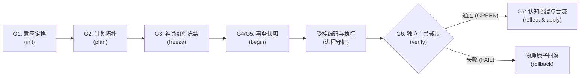

# skill-lifecycle-harness: 智能体七阶工程生命周期受控执行特种技能
### 7-Stage Controlled Engineering Lifecycle Harness Skill for AI Agents

[-purple.svg)](#)

---

## 🌟 技能使命与定位 (Mission & Agentic Role)

在智能体日常软件工程实战中，`skill-lifecycle-harness` 是 AI Agent 专属的**受控执行与反作弊防弹装具指南**。  
当开发者在会话中提出具体的代码修改、功能新增、模块重构或缺陷修复时，Agent 通过执行本 Skill 的七阶标准作业程序 (SOP)，自主调用底层 `tool-lifecycle-harness`，实现物理级的意图锁定、红灯先验断言、Git 原子快照、独立机器证据门禁与一键原子回滚。

---

## ⚖️ 核心哲学：究竟是单纯的 Tool 好，还是 Skill 指向 Tool 好？

| 维度 | 单纯做成 Tool | 单纯做成 Skill | **Skill 指向 Tool (本项目采用)** |
| :--- | :--- | :--- | :--- |
| **触发机制** | ❌ 依赖人类手动反复敲命令，AI 缺乏自主激活的条件反射 | ⚠️ AI 靠提示词自发执行，但缺乏物理能力 |  **AI 识别意图自动向底层物理装具下发指令，人类零负担** |
| **执行约束力** | 🔒 物理级约束，但若 AI 绕过它乱写文件则形同虚设 | ❌ 纯文本软约束，AI 在困难时容易放水或编造假测试 | 🛡️ **双轨共生：Skill 引导 AI 自觉穿甲，Tool 执行刚性物理拦截** |
| **反作弊能力** | 🔒 支持 SHA-256 与 AST 校验 | ❌ 无法防止模型在代码中写 `assert True` | 🎯 **双重验真：静态 AST 查杀同义反复，运行时哈希防篡改** |
| **灾难自愈** | 🔒 支持 Git 快照还原 | ❌ 无法物理回滚未提交的脏改动 | ⏪ **失败安全：一键物理原子回滚，代码库永远保持干净** |

---

## 🛠️ 七阶标准作业程序 (7-Stage SOP)

1. **G1 意图定格 (Intent Grounding)**：提取纯粹问题域，剥离口嗨与实现偏见。
2. **G2 计划拓扑校验 (Plan DAG Validation)**：校验任务无环依赖，确保可执行。
3. **G3 验收神谕红灯冻结 (Oracle Red-State Freezing)**：先写测试，验证修改前确实报错（红灯），锁定 SHA-256 签名。
4. **G4/G5 事务快照开启 (Snapshot & Sandbox)**：打下 Git 原子快照，受控编码，进程树硬超时守护。
5. **G6 独立机器证据门禁 (Independent Evidence Gate)**：防篡改校验 + AST 反同义反复 + 物理运行验真。通过则放行，失败则一键回滚。
6. **G7 认知蒸馏与补丁合入 (Reflexion & Apply)**：沉淀只增不改 ADR 决策日志与记忆库，正式合流代码。

---

## 🛡️ 核心不变量与刚性红线 (Core Invariants)

1. **绝对禁跳步**：状态机严格单向演进（G1 -> G2 -> G3 -> G4 -> G5 -> G6 -> G7）。跳步直接抛出 `StateTransitionError`。
2. **未红不准绿**：业务代码未写前，测试必须是红的；未经历红灯验证的测试直接判定为假测试。
3. **篡改必报警**：G3 阶段冻结的测试脚本 SHA-256 在 G6 校验时若不匹配，直接触发篡改熔断。
4. **同义反复零容忍**：AST 语法树自动识别 `assert True`、`assert 1 == 1`、`assert x == x`，一经发现判定为假通过。
5. **失败安全回滚**：任何时刻陷入异常死锁或改偏，必须执行 `rollback` 彻底还原，坚决不把残次代码留在用户仓库。

---

## 🚀 安装与日常使用 (Installation & Daily Usage)

### 1. 全局智能体槽位安装
安装至全局配置目录（物理目录）：
`C:\Users\28461\.gemini\config\skills\skill-lifecycle-harness\SKILL.md`

### 2. 交互式触发方式
当用户在对话框中提出以下需求时，AI 将自动激活本技能：
- *“帮我给用户模块加上 JWT 鉴权功能”*
- *“修复并发处理时的空指针异常 Bug”*
- *“把现有单体逻辑重构为分层架构”*

Agent 将自动在目标代码库根目录下创建 `.agent_lifecycle/` 并依次驱动 G1~G7，保障交付质量 100% 可信。
