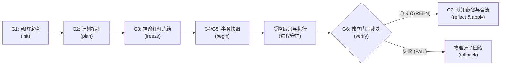

# skill-lifecycle-harness (智能体七阶工程生命周期受控执行特种技能)

本 Skill 是 AI 智能体在日常编码实战中的**外骨骼神经反射中枢**。
当用户提出“帮我实现这个功能”、“修复这个 Bug”、“重构这个模块”、“写一组测试”等代码变更指令时，**严禁大语言模型凭借概率直觉直接用文件编辑工具乱改代码，必须穿上物理装具，自主调用底层 `tool-lifecycle-harness` 驱动七阶状态机与独立证据门禁**。

---

## 🧭 核心哲学：为什么需要 Skill 指向 Tool？

```
                    【用户提出编码/修改诉求】
                               │
                               ▼
  ┌────────────────────────────────────────────────────────┐
  │  Skill（认知神经层 / Brain SOP）                        │
  │  - 监听用户意图，拦截盲目修改冲动                       │
  │  - 规定思考步骤与执行次序，自动向底层下发指令           │
  │  - 将业务语义转化为生命周期的状态机输入                 │
  └────────────────────────────┬───────────────────────────┘
                               │ 驱动物理命令 (CLI / FSM)
                               ▼
  ┌────────────────────────────────────────────────────────┐
  │  Tool（物理装甲层 / Muscle & Gate）                     │
  │  - tool-lifecycle-harness 状态机硬锁死 (严禁越权跳步)   │
  │  - G3 神谕红灯前置断言 + SHA-256 哈希防篡改锁定         │
  │  - G4/G5 Git 事务级快照与 OS 进程树硬杀守护             │
  │  - G6 独立机器证据裁决 + AST 反作弊 + 变异测试检验      │
  │  - 一旦出错一键原子回滚 (Rollback)，杜绝污染生产分支    │
  └────────────────────────────────────────────────────────┘
```

- **单纯 Tool 的缺陷**：AI 没有先天的生理记忆，遇到任务容易遗忘启动工具，退化为原生直觉乱改；若靠人类手动敲命令，人类心智负担过重。
- **单纯 Skill 的缺陷**：提示词只是“软约束”，模型在长上下文或遇到困难时会阳奉阴违、编造假测试（如 `assert True`）或把测试偷偷改绿。
- **Skill 指向 Tool（双轨共生）**：Skill 负责“意图唤醒与自主推进”，Tool 负责“物理拦截与不可违背的刚性门禁”。

---

## 🚦 触发时机边界 (Trigger Boundaries)

牢记基本工程原则：**“只读不惊动，动刀必穿甲”**。

| 场景类别 | 典型用户指令 | 动作 | 处置策略 |
| :--- | :--- | :---: | :--- |
| **只读问答** | “解释这段代码”、“这个报错一般是什么原因”、“查看接口定义” | ⚪ 跳过 | 直接回答，不触碰生命周期装具，避免过度仪式化。 |
| **新增功能 (Feature)** | “给用户模块加 JWT 鉴权”、“新增一个导出 CSV 接口” | 🟢 **强制触发** | 启动 G1~G7，先写测试红灯，打快照后再写业务代码。 |
| **缺陷修复 (Bugfix)** | “修复并发偶发锁死问题”、“处理空指针异常” | 🟢 **强制触发** | 必须先编写能复现该 Bug 的失败测试（神谕红灯），确认先验失败后再动工。 |
| **模块重构 (Refactor)** | “把单体结构重构为分层架构”、“替换旧的数据持久化层” | 🟢 **强制触发** | G4 快照保底，G6 变异与 AST 全量体检，失败即刻一键回滚。 |

---

## 🛠️ 七阶标准作业程序 (7-Stage SOP)



---

### 阶段一：G1 意图定格与解域 (Intent Grounding)

当收到用户的开发或修复诉求时，首先在目标仓库根目录初始化生命周期：
```bash
python D:/github/tool-lifecycle-harness/main.py init "<用户原始核心诉求>"
```
* **底层装具动作**：自动剥离用户提示词中的技术手段私货，提取核心问题域与显式红线，写入 `.agent_lifecycle/state.json`。

---

### 阶段二：G2 计划拓扑校验 (Plan DAG Validation)

编写结构化原子任务清单 `plan.json`，并执行拓扑校验：
```json
{
  "tasks": [
    {
      "task_id": "T1",
      "description": "编写 JWT 鉴权失败与过期的拦截测试用例",
      "dependencies": [],
      "oracle_file": "tests/test_auth.py"
    },
    {
      "task_id": "T2",
      "description": "实现 JWT Token 签发与 Header 提取中间件",
      "dependencies": ["T1"]
    }
  ]
}
```
执行计划校验指令：
```bash
python D:/github/tool-lifecycle-harness/main.py plan plan.json
```
* **装具拦截点**：若存在循环依赖（Deadlock DAG）或任务缺少验证目标，状态机抛出异常，强制纠偏。

---

### 阶段三：G3 神谕前置与红灯哈希冻结 (Oracle Red-State Freezing)

**核心铁律**：严禁在写完业务代码之后再“补测试”。必须**先写测试**，并在此阶段执行并确认失败！

1. 智能体编写验证该功能/缺陷的测试脚本（例如 `pytest tests/test_auth.py`）。
2. 执行神谕冻结命令：
```bash
python D:/github/tool-lifecycle-harness/main.py freeze "python -m unittest tests/test_auth.py"
```
* **装具物理动作**：
  - 立即在沙盒中试运行该神谕命令。
  - **红灯先验断言**：修改前执行该测试**必须报错/失败（Exit Code != 0）**！若修改前直接通过（绿色），装具直接拒绝冻结，发出“假测试/空测试”严重警报！
  - 自动扫描测试文件的 SHA-256 哈希值与 AST 语法树结构，封存入状态机。

---

### 阶段四：G4/G5 事务快照与安全编码 (Snapshot & Execution)

在正式修改工程代码前，开启事务保护：
```bash
python D:/github/tool-lifecycle-harness/main.py begin T2
```
* **装具物理动作**：
  - 自动创建 Git 快照锚点（保存当前 HEAD 与未提交变更）。
  - 状态机锁定为 `CHECKPOINT_SECURED`。
* **智能体执行**：
  - 此时智能体可以使用标准文件编辑工具实现业务代码。
  - 运行命令测试时，内置操作系统级进程树硬超时守护（默认 30s），杜绝死循环阻塞。

---

### 阶段五：G6 独立机器证据裁判 (Independent Evidence Gate)

代码编写完毕后，智能体**严禁主观宣称“我已经修复了”**，必须由底层装具出具机器裁判裁决：
```bash
python D:/github/tool-lifecycle-harness/main.py verify
```

#### 判决分流：
1. **通过 (Exit Code 0)**：
   - 物理神谕真实运行通过。
   - 测试文件 SHA-256 与 G3 冻结阶段完全一致（AI 未私自放宽断言）。
   - AST 静态筛查通过（未包含 `assert True` 等同义反复作弊代码）。
   - 状态机推进至 `G6_EVIDENCE_VERIFIED`。
2. **拒绝 (Exit Code != 0)**：
   - 如果神谕未通过，或发现测试文件被篡改：
   - 智能体可选择继续排查修改，或者调用**一键物理原子回滚**：
     ```bash
     python D:/github/tool-lifecycle-harness/main.py rollback
     ```
     一键抹除脏改动，使代码库瞬间回归干净基线。

---

### 阶段六：G7 认知蒸馏与补丁合流 (Reflexion & Apply)

证据检验通过后，将本次经验沉淀为系统永久记忆：
```bash
python D:/github/tool-lifecycle-harness/main.py reflect "决策: 采用 HMAC-SHA256 对称签名减少外部密钥服务依赖" "pitfall: 注意 Authorization 头格式必须为 Bearer 加单个空格"
```
* **装具物理动作**：
  - 自动生成结构化架构决策记录（`docs/adr/ADR-xxx.md`）。
  - 追加至长期避坑记忆库（`.agent_lifecycle/memory.json`）。

最后，审查并正式合入工作区代码：
```bash
python D:/github/tool-lifecycle-harness/main.py apply
```

---

## 🛡️ 核心不变量与刚性红线 (Core Invariants)

1. **绝对禁跳步**：生命周期状态机单向不可逆流动（G1 -> G2 -> G3 -> G4 -> G5 -> G6 -> G7）。跳步直接抛出 `StateTransitionError`。
2. **未红不准绿**：业务代码未写前，测试必须是红的；没有红过的测试不具备任何可信度。
3. **篡改必报警**：G3 阶段冻结的测试脚本 SHA-256 在 G6 校验时若不匹配，直接触发篡改熔断。
4. **同义反复零容忍**：AST 语法树自动识别 `assert True`、`assert 1 == 1`、`assert x == x`，一经发现判定为假通过。
5. **失败安全回滚**：任何时刻陷入异常死锁或改偏，必须执行 `rollback` 彻底还原，坚决不把残次代码留在用户仓库。
